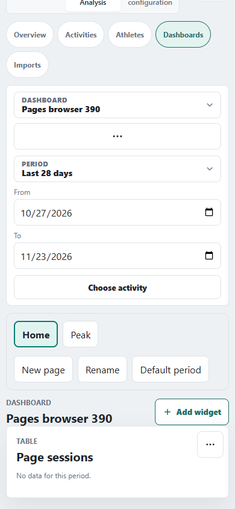
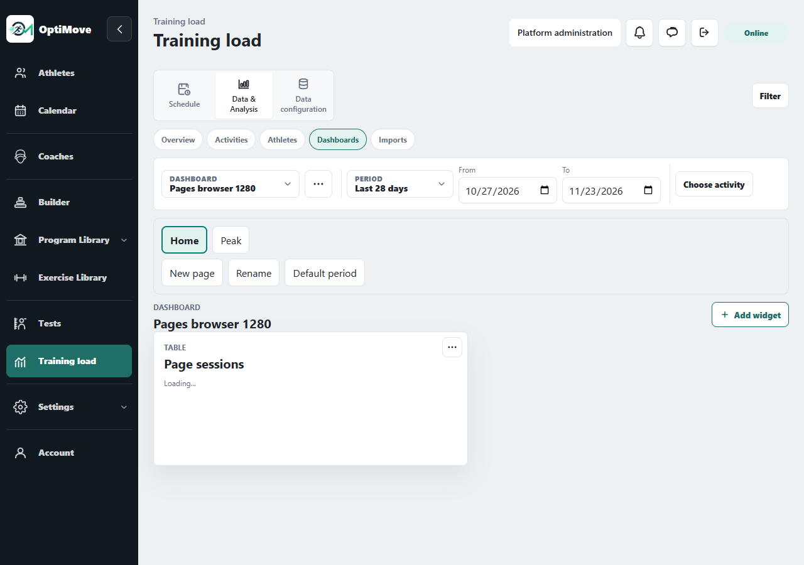

# P1 Pages — review evidence

This is a RISKY draft-review packet, not a production GO. The frozen head is in the PR header. The server flag `DASHBOARD_PAGES_ENABLED` and the separate database switch both default closed. No production SQL, merge, deploy or activation was performed by this work.

## Completed P1 checks

Environment: Windows; Node 22.22.0; local PostgreSQL 17.11; Chrome 158.0.8127.36. Production is PostgreSQL 17.6, so the owner's PG17 rehearsal remains a separate prerequisite.

| Repository runner file | Passed |
| --- | ---: |
| dashboard-pages-migration.test.mjs | 18 |
| dashboard-pages-writers.test.mjs | 6 |
| dashboard-pages-v91-rollback.test.mjs | 1 |
| dashboard-pages-legacy-server.test.mjs | 16 |
| dashboard-pages-disposable.test.mjs | 12 |
| dashboard-pages-access.test.mjs | 9 |
| dashboard-pages-concurrency.test.mjs | 8 |
| Total real-database P1 tests | 70 |
| e2e/tests/dashboard-pages.test.mjs | 7 |

The migration cases execute the actual SQL and runbooks, including application, guarded rollback, catalog equality and reapplication. Catalog equality includes ownership, ACLs, RLS, policies, constraints, indexes, triggers and function definitions. Optional v88/v89 are exercised absent, individually present, and present in both application orders. The A-only owner command applies no optional migration and refuses an unrecorded prerequisite.

The seven browser cases cover 360/390/1280 px, create/rename/reorder controls, duplicate/empty names, shared period, Simple save, copy, nonempty deletion refusal, empty deletion, remembered selection, late responses after dashboard navigation, coach/admin DOM without technical details, and a browser clock ten minutes ahead. Widget editing waits for the Page reload/save/recovery to finish.

The confirmed previous production binary is **aa6e765c86525f23d4ff970c9fa550b4183bae01**, supplied from `/api/health` at 2026-11-23 08:13:01 UTC. Its unchanged archived source passed the 16 old-server checks. Historical 4301851 evidence remains a dated snapshot only. The rehearsal accepts a fresh owner-confirmed `--old-build` SHA.

Commands (from the repository root; local connection only):

```text
node backend/scripts/dashboard-pages-rehearsal.mjs --host 127.0.0.1 --port 55439 --pg-bin "C:/Program Files/PostgreSQL/17/bin" --old-build aa6e765c86525f23d4ff970c9fa550b4183bae01
node scripts/test-runner.mjs --project backend --file dashboard-pages-migration.test.mjs
node scripts/test-runner.mjs --project backend --file dashboard-pages-legacy-server.test.mjs
node scripts/test-runner.mjs --project e2e --file dashboard-pages.test.mjs
node scripts/test-runner.mjs --project frontend --file training-load-pages-view.test.mjs
node scripts/test-runner.mjs --project frontend --file training-load-analysis.actions.test.mjs
npm --prefix frontend run build
```

Both `.ps1` and `.sh` wrappers rejected a non-loopback host before any connection/password handling. The full PowerShell wrapper also returned `RESULT: PASS` on the local PG17 cluster. The Linux wrapper and production PG17.6 are for the owner's rehearsal.

## Broad gates and baseline comparison

The paired fast gates used clean main **74331c287628f9d1a86ef0bcfd6e0fb4664980d4**, the same Node version and dependency locks. The subsequent aa6e765c main change is backend-only. Exact file-level failure names and counts match between P1 and the clean baseline.

| Command | P1 | Clean main |
| --- | --- | --- |
| `node scripts/test-runner.mjs --preset frontend-fast` | 299 files: 272 pass, 4 known-fail, 23 fail; 4120 passed / 61 failed of 4181 tests | 298 files: 271 pass, 4 known-fail, 23 fail; 4110 passed / 61 failed of 4171 |
| `node scripts/test-runner.mjs --preset backend-fast` | 64 files: 58 pass, 6 fail; 655 passed / 89 failed of 744 tests | 63 files: 57 pass, 6 fail; 653 passed / 89 failed of 742 |
| frontend build | PASS | Not repeated; P1 build passed |

No new known-failure entry was added. The one manifest kind override is the pure rehearsal CLI argument/URL test: it opens no database or socket. All seven database P1 files run as disposable tests.

The overnight broad runs were affected by computer suspension (Windows records resume at 08:40 local on 23 November). Their multi-hour timeout totals are **not GO evidence**. Raw results are retained without calling them green:

| Broad command | Raw P1 result | Raw clean-main result |
| --- | --- | --- |
| `node scripts/test-runner.mjs --project backend --kind disposable` | 190 files: 168 pass, 1 known-fail, 14 fail, 2 timeout, 5 crash; 3334 passed / 17 failed of 3352 reported tests | 183 files: 161 pass, 1 known-fail, 13 fail, 3 timeout, 5 crash; 3260 passed / 17 failed of 3278 reported tests |
| `node scripts/test-runner.mjs --preset e2e` | 76 files: 73 pass, 2 fail, 1 timeout; 390 passed / 2 failed of 392 reported tests | Whole preset not repeated on main |

Follow-up while the system was held awake:

- P1-only differences in `source-metric-mapping-m2`, `source-metric-mapping-transitions-7b` and `tests-module-schedule-management` passed 26/26, 17/17 and 48/48.
- Main-only sleep-affected `training-load-dashboard`, `support-disposable-db` and `team-dashboards-club-variables-o7` passed 154/154, 6/6 and 11/11.
- Three media files first lacked `MEDIA_TEST_DATABASE_URL`. With it explicitly set to a separate local disposable-capable cluster, retention/storage/upload passed 24/24, 14/14 and 31/31.
- E2E `central-calendar-k2c3` passed 4/4 on both main and P1 without an application change.
- The E2E Pages setup failures were fixed and the final Page file passed 7/7.
- `imports-period` was intermittent: main had both 4/4 and 3/4 runs; its mouse-drag failure also appeared on P1. One P1 rerun additionally observed the phone focus assertion. The final P1 reruns passed 4/4, including on the updated main. No GPS file was changed by P1.

The uninterrupted full disposable and E2E sets have **not** been repeated after the final main integration. The reviewer/independent Linux gate on the frozen merge preview is still required.

## Actual mutations

| Mutation | Result |
| --- | --- |
| Remove Page-parent intersection | Killed by access tests |
| Replace manage permission with view permission | Killed by access tests |
| Omit Page identity/defaults from the preview fingerprint | Killed by the token-binding test |
| Remove the independent data-workspace gate | Initially survived because the fixture selected an unavailable workspace; after granting the real club role before switching workspace, killed by the specific workspace test |

Other planned mutations were not executed and are not claimed as covered. Every mutated source file was restored before the final checks.

## Operator boundaries

See the v90/v91 runbooks. A is a separately ordered compatible deployment; B is another order. Normal application startup must not install another pending independent migration under the B order. Every old instance must be drained before activation. Never delete receipts or bypass rollback refusals to make rollback succeed.

Not performed: production preflight/application/postcheck/activation/deploy; owner PG17.6 rehearsal; Linux validation. Broad rewriting of unrelated line endings was not performed. Screenshots below are repository review evidence, not GitHub comment attachments.

## Visual evidence

[360 px screenshot](dashboard-pages-p1-evidence/pages-360.png)

390 px:



1280 px:



## Independent-review delta from bec894b8 (2026-11-23)

M-1: save_simple_page_widget's first executable statement now takes the exact same
dashboard-simple:<initiator>:<request> advisory transaction lock as the legacy save.
Only then may it acquire the dashboard and Page locks. Nested acquisition is reentrant.
The new real-DB concurrency test holds that key on another connection, waits until the
Page save is blocked on advisory, and obtains the dashboard FOR UPDATE NOWAIT on a
third connection. Removing the first advisory acquisition makes that test fail: the
legacy nested acquisition is too late and the dashboard is already locked.

L-1: hold a Page row lock on a separate connection, then call assert_dashboard_writable
with a bounded lock_timeout; it must wait/refuse with 55P03. Removing only the Page
FOR UPDATE from the installed assertion body makes the test fail. The tests mutate
fresh disposable installed bodies after migration, so an md5 gate is not the reason
for either killed mutation. Both mutation runs: 7 passed / 1 failed of 8, the intended
new test only. All mutated bodies/test injections were restored.

L-2: the additional A-only test executes the exact Page-state guard extracted from
the real v90 rollback SQL, with a test-only non-Home row whose other legacy fields
look unchanged. The valid Home still exists and no widget references that extra row.
The duplicate-name index is removed only inside this disposable fixture transaction;
position uniqueness is deferred. This isolates not-is_home from other guard branches
and from later DDL. Removing that predicate produces Missing expected rejection.
Full rollback execution/catalog equality remains covered by the other A/B tests.

L-3: ADR-003 explicitly lists cloneDashboard and the sanctioned SQL copy function as
the two composite raw-INSERT implementations. No raw Page route/service writer is
authorized by that exception.

Existing training-load-dashboard.test.mjs now applies v84 + v90 + v91, retains the
production migrations_v2 identity in every fixture directory, compares the exact
dashboard migration list, and isolates v71 rollback at its actual predecessor set.
Its atomic-save table snapshot now expects the Page revision trigger's table change.
Final run: 154/154; no test is disabled or marked known-fail.

Review commands (Node22.22.0, local PG17.11, loopback55442):

- node backend/scripts/dashboard-pages-rehearsal.mjs --port 55442 --pg-bin
  "C:/Program Files/PostgreSQL/17/bin": RESULT: PASS, 70/70 across all seven P1 files.
  Includes 16/16 unchanged aa6e765c old-server flows and A/B rollback/catalog/reapply.
- node scripts/test-runner.mjs --project backend --file training-load-dashboard.test.mjs:
  154/154 after the fixture corrections.
- node scripts/test-runner.mjs --project backend --file dashboard-pages-concurrency.test.mjs:
  8/8; the rehearsal repeats it unmutated.
- L-2 mutation: node --test --test-name-pattern="v90 rollback independently"
  backend/tests/dashboard-pages-migration.test.mjs: 0/1 (expected assertion failure).

The owner's production-matching PG17 rehearsal must use this NEW v91 artifact:
SHA256 1da5706c418c0f3262d6a88689e8d1355247a97d7d31bad4a82a59d396c52247.
The updated save wrapper prosrc md5 is 545aa60b5d53f0df2d6a9f4c39d5150b.
Both runbooks and the owned-function fixture are updated; v90 is unchanged.

No frontend code changed in this delta. Frontend/build/E2E and the whole disposable
family were not rerun for this backend/test/doc delta; their previous evidence and
limitations above remain historical. Reviewer full gate and owner rehearsal are still
required. No production access, migration, activation, merge or deploy was performed.

After isolating the L-2 guard from fixture DDL events, the complete migration file
was rerun unmutated with the repo runner: 18/18, cleanup audit clean. The L-2 mutant
then fails only its named guard test with Missing expected rejection (0/1).
